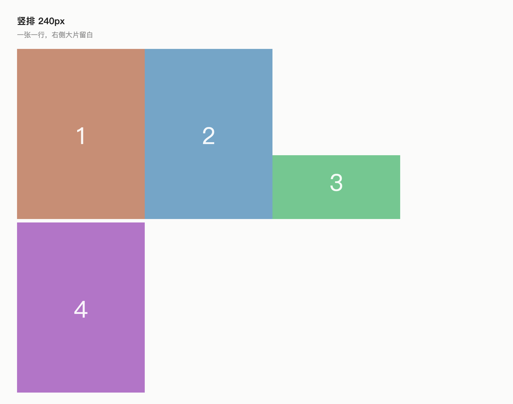
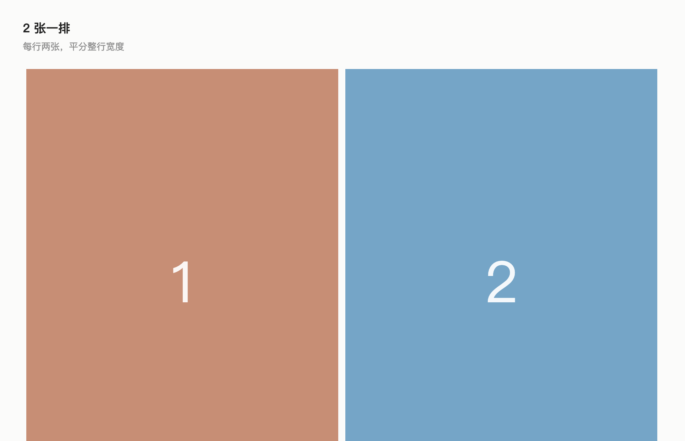
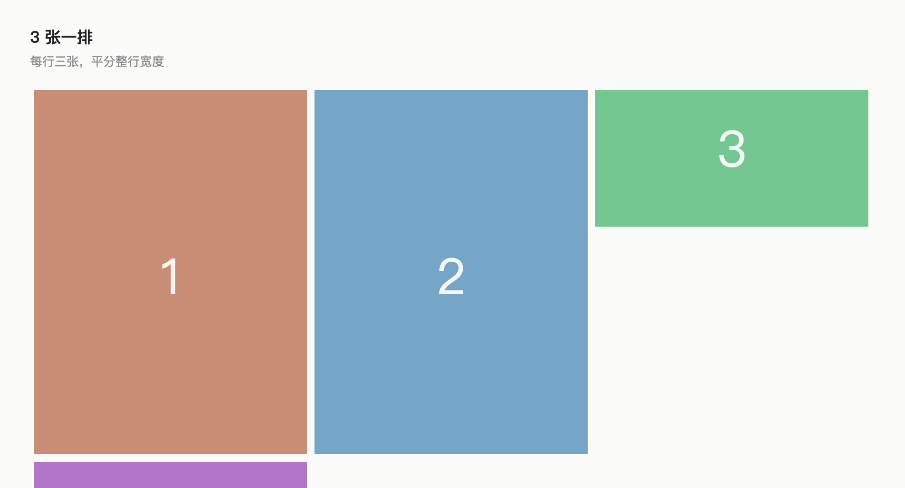

# Image Size Presets

Set a default image size for **a note**, **a folder**, or **your whole vault** — with one click, no CSS and no per-image dragging.

Obsidian shows images at their natural resolution, so a 2940px screenshot fills the editor. Dragging the corner of every pasted screenshot gets old fast. This plugin replaces that with six presets and three scopes.

 

| Stacked (240px) | 2 per row | 3 per row |
| :---: | :---: | :---: |
|  |  |  |

## What it does

Click the image icon in the ribbon (or run **Image size: open image size picker**):

- **Scope**: this note / this folder / all notes
- **Size**: Tiny 160 · Small 240 · Medium 400 · Large 640 · Extra large 900 · No limit
- **Layout**: stacked / 2 per row / 3 per row
- **Alignment**: left / center / right / follow default
- A status line naming the value in effect and which layer it came from

Pick a size, the panel closes, done.

## The chosen size wins

By default a preset **overrides the inline `|300` width** an image may carry. That is what makes the control feel responsive: switching 240 → 400 → 640 changes every oversized image in the note immediately.

Two properties are preserved:

- **Small images are not upscaled.** The image renders at its natural width, then the cap applies — a 160px icon stays 160px no matter which preset is active.
- **Nothing is written into your notes.** The size lives in frontmatter (`image-width: 400`) and in plugin settings, never in the image embeds.

If you would rather keep hand-tuned inline widths, turn off **Unify width** in the plugin settings. Images then only shrink when they exceed the cap, and `|300` wins as before.

## Precedence

1. **This note** — `image-width: 400` in frontmatter (set `none` for no limit). Editable in the Properties panel.
2. **This folder** — stored in plugin settings; the deepest matching rule wins (`AI learning/sub` beats `AI learning`).
3. **Global default** — 560px.

Alignment resolves the same way, using `image-align: center` in frontmatter.

## Alignment

Left / center / right is opt-**in** per note, folder, or globally. It sets `display: block`, which means images you deliberately placed side by side on one line will stack vertically. That is why "follow default" is the default: untouched notes keep Obsidian's inline layout.

## Layout

Stacked, 2 per row, or 3 per row, with the same note → folder → vault precedence. Images that sit on the **same line** share that line's width evenly; a note where every image is on its own line keeps one image per line, because Markdown paragraphs do not merge.

Choosing a multi-column layout replaces the pixel cap with a percentage of the row, so the preset size no longer applies exactly — that is the trade for not wasting the right half of the pane. The status line says so while a multi-column layout is active.

Images must end up on **one line** for this to work. A line break between embeds is a hard break in reading view and a separate block in Live Preview, so picking a column layout for the current note merges adjacent image-only lines in the source — undoable, and only lines that contain nothing but embeds are touched.

Alignment is hidden in multi-column mode on purpose: it forces `display: block`, which would undo the columns.

## Settings

| Setting | Default | Meaning |
| --- | --- | --- |
| Unify width (ignore inline `\|width`) | on | Chosen size applies to every image; off restores cap-only behaviour |
| Default maximum width | 560 | Fallback for notes without their own value. `0` = no limit |
| Default maximum height | 0 | Optional cap for tall screenshots. A height cap binds before the width, which makes the chosen width look wrong — leave it at 0 |
| Default alignment | follow default | Fallback alignment |
| Default layout | stacked | Fallback layout |
| Folder rules | empty | Added when you pick "this folder"; deletable |

| Stacked (240px) | 2 per row | 3 per row |
| :---: | :---: | :---: |
|  |  |  |

## What it does not touch

- **Canvas and Excalidraw** embeds — not `` elements inside a Markdown view.
- **Pandoc / PDF / Word exports** — those read the width written in the Markdown, not what is displayed on screen.

## How it works

Two rules in `styles.css`:

```css
.markdown-preview-view img, .markdown-reading-view img,
.markdown-rendered img, .markdown-source-view.is-live-preview img {
	max-width: min(100%, var(--isp-width, 100%));
	max-height: var(--isp-height, none);
}

.isp-force img { width: auto !important; }

.isp-layout-cols2 img { width: calc(50% - 11px) !important; margin: 5px; }
.isp-layout-cols3 img { width: calc(33.333% - 9px) !important; margin: 4px; }
```

On every file open, layout change and metadata change the plugin resolves width, alignment and the override flag for each open Markdown pane, then writes `--isp-width` / `--isp-height` and the classes onto that pane's container. No runtime `<style>` injection, so pop-out windows behave the same.

Clicking a preset paints the new value immediately and reconciles a moment later, so the picker never feels laggy while the metadata cache catches up.

Two details exist to stop images from flickering:

- While Obsidian is rebuilding its metadata cache, `getFileCache()` returns `null`. That is treated as "not ready yet" and the pane is left alone — falling back to the default width there would resize every image and force a re-decode.
- The computed state for a pane is compared against the last applied one, so an unchanged note is never touched. Obsidian fires a metadata-changed event on every keystroke; without the comparison a 60-image note would re-layout constantly.

## Development

```bash
npm install
npm run dev    # esbuild watch
npm run build  # tsc --noEmit + production bundle
npm test       # node:test: resolution, CSS contract, render model
npm run lint   # eslint + eslint-plugin-obsidianmd
```

`main.js` is a build artifact and is not committed; releases attach it.

## Known limitations

- Settings rows do not appear in Obsidian 1.13+'s settings search yet (the declarative `getSettingDefinitions()` API is not adopted).
- Folder rules match by path prefix, not by glob.
- A max-height above 0 takes priority over the width on tall images, and also shrinks cells inside a multi-column layout.
- Multi-column layouts only regroup images that already share a line; Markdown paragraphs are not merged.

## License

MIT
