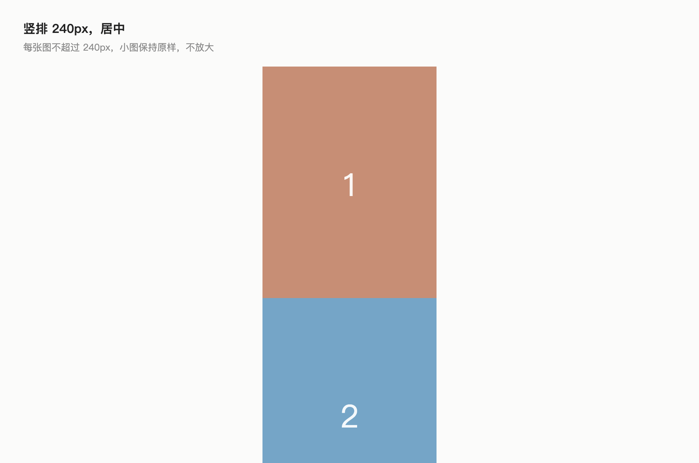

# 图片大小预设 (Image Size Presets)

一次点击，给**一篇笔记**、**一个文件夹**或**整个库**设定图片显示大小。不用写 CSS，也不用一张张拖动角点。

Obsidian 默认按原始分辨率显示图片，一张 2940px 宽的截图会占满编辑区。每贴一张都拖一次，时间久了很烦。这个插件把这件事变成两次点击。

 



## 怎么用

点左侧边栏的图片图标（或命令面板执行 **图片大小：打开图片大小面板**）：

- **作用范围**：本笔记 / 本文件夹 / 全部笔记
- **大小**：极小 160 · 小 240 · 中 400 · 大 640 · 特大 900 · 不限
- **对齐**：左 / 居中 / 右 / 跟随默认
- **状态行**：告诉你当前实际生效的值，以及它来自哪一层

选一个，面板自动关，立刻生效。

## 选定的大小会压过图片自带宽度

默认情况下，预设会**覆盖图片自带的 `|300` 宽度**。这是它"灵敏"的关键：240 → 400 → 640 之间切换时，笔记里每张超宽的图都会立刻跟着变。

同时保留两个性质：

- **小图不会被放大。** 图片先按原始宽度渲染，再套上限——160px 的图标不管选哪档都还是 160px。
- **不往笔记正文里写东西。** 尺寸存在 frontmatter（`image-width: 400`）和插件设置里，永远不改图片嵌入语法。

如果你更想保留手调的宽度，去插件设置里关掉 **统一宽度**。那时图片只在自己超过上限时才缩小，`|300` 照旧优先。

## 优先级

1. **本笔记** —— frontmatter 里的 `image-width: 400`（填 `none` 表示不限制），可在「属性」面板里改。
2. **本文件夹** —— 存在插件设置里；子文件夹取最精确的那条（`AI learning/sub` 优先于 `AI learning`）。
3. **全局默认** —— 560px。

对齐用同一套优先级，frontmatter 键是 `image-align`。

## 设置页

| 设置 | 默认 | 说明 |
| --- | --- | --- |
| 统一宽度（忽略图片自带的 `\|宽度`） | 开 | 选定的大小对每张图都生效；关掉后只在自己超过上限时缩小 |
| 默认最大宽度 | 560 | 没单独设置过的笔记用它。`0` = 不限制 |
| 默认最大高度 | 0 | 可选的竖长图上限。**高度会先于宽度生效，导致你选的宽度看起来不准，建议保持 0** |
| 默认对齐 | 跟随默认 | 兜底对齐方式 |
| 文件夹规则 | 空 | 选「本文件夹」时自动添加，可删除 |

## 它管不到的地方

- **Canvas 和 Excalidraw** 里的图片 —— 它们不是 Markdown 视图里的 ``。
- **Pandoc / PDF / Word 导出** —— 导出读的是 Markdown 里写的宽度，不是屏幕上的显示效果。

## 实现方式

`styles.css` 里两条规则：

```css
.markdown-preview-view img, .markdown-reading-view img,
.markdown-rendered img, .markdown-source-view.is-live-preview img {
	max-width: min(100%, var(--isp-width, 100%));
	max-height: var(--isp-height, none);
}

.isp-force img { width: auto !important; }
```

每次打开文件、布局变化、元数据变化时，插件为每个 Markdown 窗格算出宽度、对齐和覆盖开关，把 `--isp-width` / `--isp-height` 和对应 class 写到该窗格容器上。不注入运行时 `<style>`，所以弹出窗口表现一致。

三个细节是为了不让图片闪烁或漏设：

- 点预设时**立刻**把新值画上去，稍后再校准，面板手感不发飘
- Obsidian 重建元数据缓存时 `getFileCache()` 返回 `null`，此时**不动**并稍后重试，而不是回退到默认宽度把每张图都改一遍
- 算出的状态会和上次应用的比对，没变化就完全不碰 DOM（打字时每次按键都会触发元数据事件）

## 开发

```bash
npm install
npm run dev         # esbuild 监听
npm run build       # tsc 类型检查 + 生产打包
npm test            # node:test：解析、渲染模型、窗格状态、CSS 契约
npm run test:layout # 无头 Chrome，量真实像素宽度
npm run preview     # 重新生成 docs/screenshot-stack.png
npm run lint        # eslint + eslint-plugin-obsidianmd
```

`main.js` 是构建产物，不入库；由 Release 附带。

## 已知限制

- 设置项还没接入 Obsidian 1.13+ 的设置搜索（尚未采用声明式 `getSettingDefinitions()` API）。
- 文件夹规则按路径前缀匹配，不支持 glob。
- 最大高度设成大于 0 时，竖长图片会先撞高度，导致宽度不准。

## 许可证

MIT
